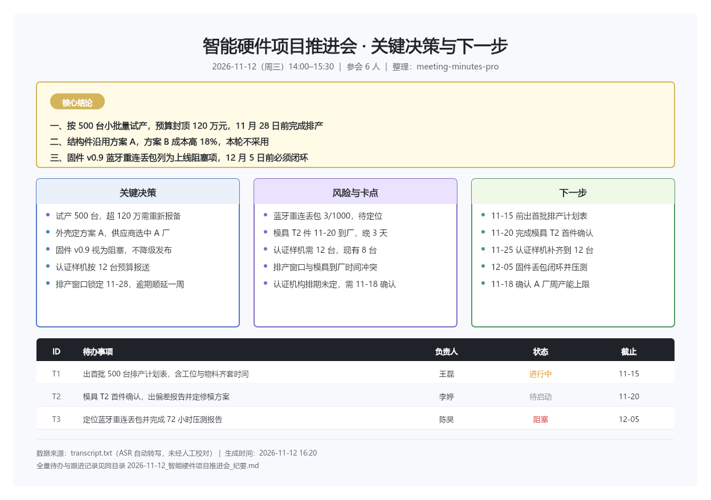

# meeting-skill

把一段**杂乱的会议稿**，变成两个能直接用的本地文件：一份 Markdown 会议纪要，和一张一页纸的 SVG 看板图。待办事项带负责人和跟踪人，可以增量更新。

全程离线：不连飞书，不调任何 API，不装额外依赖。

本项目基于 [JerryWoo/meeting-minutes-pro](https://github.com/JerryWoo/meeting-minutes-pro) 重做，已移除全部飞书链路

## 产出

```
2026-11-12_智能硬件项目推进会_纪要.md      ← 人读、存档、可更新
2026-11-12_智能硬件项目推进会_看板.svg     ← 投屏、贴群、导出 PNG
```

Markdown 里包含：

1. 一句话结论
2. 核心结论 3 条（带说话人与时间点，可回溯原文）
3. 3–5 个分主题纪要（按议题组织，不按时间流水账）
4. 关键数字表（原值不改，标注口径与来源）
5. 图表区（方案对比表必填，流程/占比用 Mermaid）
6. 待办与跟踪表（负责人 + 跟踪人 + 状态 + 按人汇总 + 跟进记录）
7. 待确认事项
8. 原文存疑点（疑似 ASR 错字，不擅自改）

SVG 看板是五区固定布局：标题 → 核心结论（黄底）→ 三栏彩色卡（决策/风险/下一步）→ 待办跟踪条 → 页脚来源。双击用浏览器打开就能看；要 PNG 就打印成 PDF 或截图。



## 安装

把这个目录放进你的 Agent skills 目录即可（Claude Code：`~/.claude/skills/`；其他宿主按各自的 skills 路径放）。`SKILL.md` 的 frontmatter 已经写好触发条件。

也可以直接 clone：

```bash
git clone https://github.com/Eorrik/meeting-skill.git
```

不想装也行：直接对 Agent 说"读 `meeting-skill/SKILL.md`，按它处理 transcript.txt"，效果一样。

不装 Node 也能用——`scripts/` 下两个脚本都是可选的辅助工具。

## 使用

给它一个转写稿，然后说要纪要：

```
帮我把 transcript.txt 整理成会议纪要
```

```
这段是产品评审会的录音转写，很乱，你整理一下，画个看板，待办要写清楚谁负责
```

能吃的输入：`.txt` `.md` `.vtt` `.srt` `.json`（ASR 导出），`.docx` / `.pdf` 走 office skill；也可以直接把文本粘进来。

输出落在**输入文件所在目录**，文件名按 `{日期}_{主题前12字}` 生成。

待办跟踪模式（不重新生成纪要）：

```
T2 模具首件确认做完了，李婷那边说推迟到 11 月 25 号
新加一条：让采购问下认证周期，陈昊跟进
```

## 效果

没有装 Markdown 编辑器也能看：一条命令渲染成网页，自动用默认浏览器打开。

```bash
node scripts/preview.mjs "2026-11-12_智能硬件项目推进会_纪要.md"
```

它会在同目录生成 `…_纪要.preview.html`——正文带表格样式，页面顶部有「在新窗口打开看板 SVG ↗」按钮。加 `--no-open` 只生成不弹窗。零依赖、不起服务器、不联网。

## 结构

```
meeting-skill/
├── SKILL.md                        # 主工作流：定位输入 → 去噪 → 结构化 → 写 md → 画 svg → 自检
├── references/
│   ├── minutes-template.md         # Markdown 骨架 + 逐节写作规则 + 禁止项
│   ├── svg-board-spec.md           # 看板坐标系、配色、字符预算、排版禁忌
│   └── todo-tracking.md            # 待办字段、状态机、按人汇总、增量更新协议
├── assets/
│   └── board-template.svg          # 可直接复制的看板模板（已通过自检）
└── scripts/
    ├── check-board.mjs             # 离线 SVG 自检：XML 合法性 / 文字溢出 / 越界 / 外链
    └── preview.mjs                 # md → 自包含 HTML 预览（零依赖）
```

## License
MIT License
