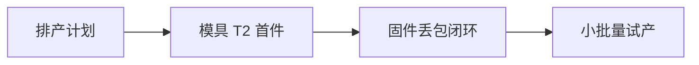

# Markdown 纪要模板与写作规则

本文件是 `SKILL.md` Step 3 的落地规范。**骨架顺序固定**，节标题编号保留，不要增删一级节（"待确认事项"和"原文存疑点"可写"无"）。

---

## 一、骨架

````markdown
# 智能纪要：{会议主题} {YYYY年M月D日}

> 会议时间：{YYYY年M月D日（周X）} {HH:MM}–{HH:MM}
> 参会人员：我司 — {姓名/角色}、…；对方 — {姓名/角色}、…
> 会议形式：{线下 / 线上会议 / 电话}
> 输入来源：`{文件名}`（{ASR 自动转写，未经人工校对 / 人工整理}）


## 1. 一句话结论

{20–50 字。写"定了什么 / 卡在哪"，不写"讨论了什么"。}

## 2. 核心结论

1. **{结论一}** — {支撑理由或约束条件}（依据：{说话人}，{时间点}）
2. **{结论二}** — …
3. **{结论三}** — …

## 3. 分主题纪要

### 3.1 {议题名（决策点式命名）}

- **{子结论 / 决策}**：{展开，含条件、边界、例外}
  - {具体数据、依据、反对意见}
  - {未解决的问题}

### 3.2 {议题名}

- …

## 4. 关键数字

| 项目 | 数值 | 口径 / 来源 |
|---|---|---|
| {试产数量} | {500 台} | {王磊，14:32} |
| {预算上限} | {120 万元} | {李婷，14:41} |

## 5. 图表

### 5.1 方案对比

| 维度 | {方案 A} | {方案 B} |
|---|---|---|
| 成本 | {…} | {…} |
| 周期 | {…} | {…} |
| 结论 | ✅ 采用 | ⚠️ 暂缓 |

### 5.2 推进流程



## 6. 待办与跟踪

状态图例：⬜ 待启动 ｜ 🟡 进行中 ｜ 🔴 阻塞 ｜ ✅ 已完成 ｜ ⚪ 已取消

| ID | 待办事项 | 负责人 | 跟踪人 | 截止 / 验收 | 状态 | 下一步 |
|---|---|---|---|---|---|---|
| T1 | {动作} | {姓名} | {姓名} | {11-15，验收：…} | 🟡 进行中 | {…} |

### 6.1 按人汇总

| 负责人 | 待办数 | 进行中 | 阻塞 | 最近截止 |
|---|---|---|---|---|
| {姓名} | {2} | {1} | {1} | {11-15} |

### 6.2 跟进记录

- **{YYYY-MM-DD}** 初次整理，建 {n} 条待办。

## 7. 待确认事项

- {无明确责任人 / 结论未定的内容}：{原文怎么说的}，{需要谁在什么时候确认}

## 8. 原文存疑点

- {疑似 ASR 错字}：原文"{…}"，疑为"{…}"，未改，待确认。
````

---

## 二、逐节规则

### 标题与元数据

- 标题固定前缀 `智能纪要：`，日期用中文年月日，不加"会议纪要"重复词。
- `输入来源` 行是**可信度声明**，必须写：转写稿未经校对就明确写出来。读者据此决定要不要复核数字。
- 参会人分"我司 / 对方"两栏；分不清归属就只列人名。
- 看板图一律用相对路径 `./`，不要写绝对路径（换机器就断）。

### 1 一句话结论

判断句，不是目录。反例："会议围绕试产、模具、固件三个议题展开。" 正例："首批按 500 台试产、预算封顶 120 万，固件丢包列为上线阻塞项。"

### 2 核心结论

- 恰好 3 条（不足 3 条写实有数量，不硬凑）。
- 每条 = **判断 + 理由/约束 + 出处**。出处写说话人和时间点，便于回溯到转写稿。
- 只写形成的结论；讨论过程留给第 3 节。

### 3 分主题纪要

- 3-5 个议题，`###` 三级标题，按**重要性**排，不按时间排。
- 议题名是"决策点"：`试产规模与预算` ✅ / `关于生产的事情` ❌ / `14:30 的讨论` ❌。
- 每条要点是一个可独立阅读的完整信息单元，不写"他说…他又说…"。
- 嵌套最多 3 层（`-` → `  -` → `    -`）。
- 分歧要保留：写成"双方观点"两项，不要和稀泥成一句"达成共识"。

### 4 关键数字

- 表格承载所有数字，方便扫读和核对；正文里仍保留必要数字。
- `口径 / 来源` 列写说话人 + 时间点；说不出源的数字，标注"推断，待确认"。
- 单位不换算（"2 万/台"不写成"20000 元/台"）。

### 5 图表

- **对比类议题必须有表**。维度行至少 3 个（成本、周期、风险之类），结论行用 ✅/⚠️/❌ 一眼可判。
- **流程/架构/关系** 用 Mermaid `flowchart` / `sequenceDiagram`，节点文字控制在 12 字内。
- **占比类**（3 组以上可量化数据）可用 Mermaid `pie`。
- 降级规则：不确定目标查看器是否渲染 Mermaid 时，改用表格或有序列表。**Mermaid 只是锦上添花，表格才是底线**。
- 不要为了凑图硬造对比；没有对比就删掉这一节。

### 6 待办与跟踪

见 [`todo-tracking.md`](todo-tracking.md)。要点：ID 稳定、负责人具体、验收可判断、按人汇总不重复。

### 7 待确认事项

- 承接三类内容：无责任人的行动计划、结论未定的议题、需要外部输入才能推进的事。
- 写法：`{事项}：{原文怎么说}，需 {谁} 在 {何时} 前确认`。

### 8 原文存疑点

- 只列**影响事实判断**的疑似错字（数字、型号、公司名、专业术语），口语误听不必列。
- 不擅自改原文，把判断权交回用户。

---

## 三、禁止项

| 禁止 | 原因 |
|---|---|
| 按时间线复述发言 | 纪要的价值在提炼，不在留档 |
| 改写或模糊化数字 | 数字是纪要里唯一不能失真的东西 |
| 给未点名的人派活 | 造责任人是纪要最常见的事故 |
| 嵌套超过 3 层 | 手机上看会糊成一团 |
| Mermaid 里塞长句 | 节点撑爆画布 |
| 用绝对路径引用看板图 | 换机器即断链 |
| 把"讨论了"写成"决定了" | 结论强度必须与原文一致 |
| 空表格凑格式 | 没有内容就整节删掉 |
